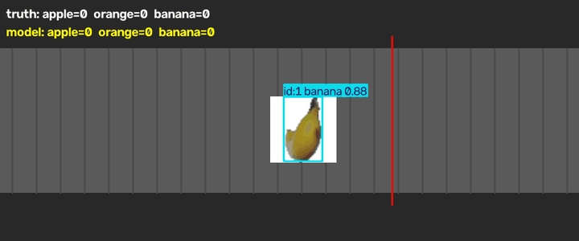
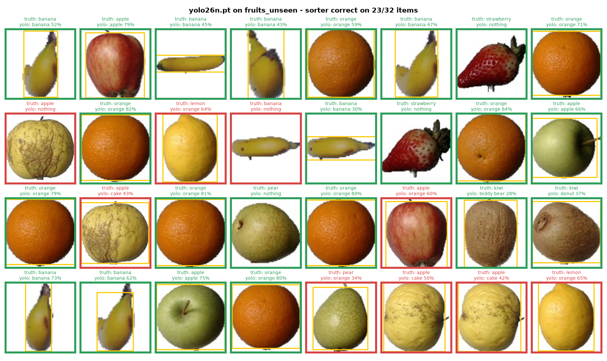
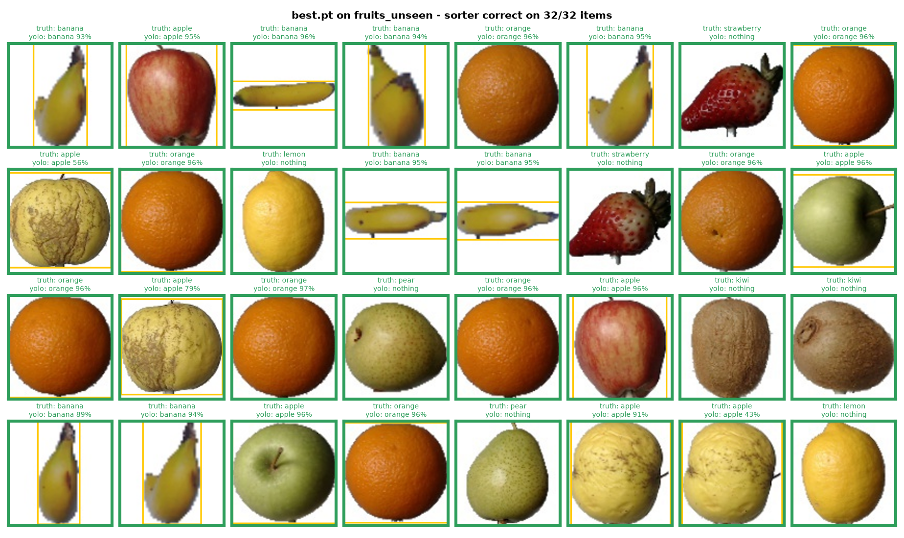
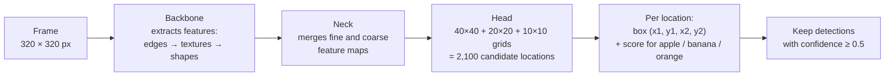
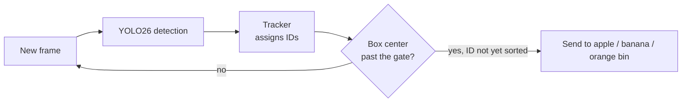
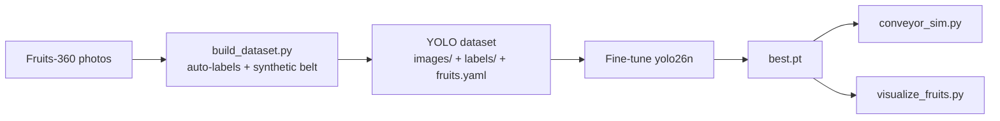

# 🍎🍌🍊 YOLO Fruit Sorter

**Real-time fruit detection and sorting on a simulated conveyor belt, powered by a fine-tuned Ultralytics YOLO26 model.**


<p align="center">
  
</p>

The model watches a conveyor belt, finds every **apple, banana and orange**, follows each one from frame to frame, and sends it to the right bin when it crosses the sorting gate (the red line). Other fruit, such as lemons, kiwis, pears and strawberries, is **ignored on purpose**, so it never ends up in a target bin.

You don't need any hardware. The conveyor is simulated in OpenCV, so the whole pipeline (detection, tracking and the sorting decision) runs on a laptop CPU.

---

## Highlights

- **No hand labeling.** Training data is generated and labeled automatically from [Fruits-360](https://github.com/Horea94/Fruit-Images-Dataset) photos (see [How the dataset is built](#how-the-dataset-is-built)).
- **Hard negatives.** Lemons, kiwis, pears and strawberries appear in training images *without* labels, which teaches the model to leave look-alike fruit alone.
- **Detection and tracking.** Every fruit keeps the same ID across frames, so it is counted exactly once at the gate.
- **Built-in check.** The simulator shows the true count next to the model's count in real time, so you can see straight away when the model gets one wrong.
- **Small and fast.** The model has 2.5 M parameters (a 5.4 MB `best.pt`), uses 320 px input, and was trained on a CPU in about 38 minutes.

---

## Results

### Before vs. after fine-tuning (held-out photos)

Both models were tested on `fruits_unseen/`: 32 photos from the Fruits-360 **Test** split that were never used for training. 24 of them are target fruit and 8 are distractors. An item counts as **correct** when the sorter would do the right thing with it: a target fruit has to get the right label, and a distractor must not be sent to a target bin.

| Model | Correct sorting decisions |
|---|---|
| `yolo26n.pt`: COCO-pretrained, not fine-tuned | 23 / 32 (72 %) |
| **`best.pt`: fine-tuned (this repo)** | **32 / 32 (100 %)** |

<table>
  <tr>
    <th>Before: <code>yolo26n.pt</code></th>
    <th>After: <code>best.pt</code></th>
  </tr>
  <tr>
    <td></td>
    <td></td>
  </tr>
</table>

The base model already knows "apple", "banana" and "orange" because they are COCO classes. But it calls **lemons "orange"**, a **golden apple "cake"**, and misses some bananas completely. After fine-tuning, every item is handled correctly.

### Validation metrics (end of training, epoch 25)

| Precision | Recall | mAP@50 | mAP@50-95 |
|:-:|:-:|:-:|:-:|
| 0.988 | 0.994 | 0.995 | 0.975 |

The validation set is built from half of the Fruits-360 Test split, using the same method as the training images.

---

## How the YOLO model works

### 1. One look at the whole image

**YOLO** stands for *"You Only Look Once"*. Older two-stage detectors first proposed regions that *might* contain an object and then classified each region separately. YOLO does it all in **one forward pass** of a neural network: the image goes in, and every bounding box and class comes out at the same time. That is why it can keep up with a moving belt.

### 2. Inside the network



| Part | What it does |
|---|---|
| **Backbone** | A stack of convolution layers. The first layers react to simple patterns like edges and colors. Deeper layers combine them into textures (orange peel, apple skin) and shapes (a banana's curve). |
| **Neck** | Combines feature maps at several resolutions. High-resolution maps are good at *where* an object is, and low-resolution maps are good at *what* it is. Merging them lets the model detect both small and large fruit. |
| **Head** | Covers the image with grids at three scales (stride 8, 16 and 32 px). Each grid cell predicts a **box** and a **confidence score for each class**. With a 320 px input, that gives 40×40 + 20×20 + 10×10 = 2,100 candidate predictions per frame. |

**YOLO26** is the newest Ultralytics generation. It is trained **end-to-end and NMS-free**: training matches each real object to exactly one prediction, so the model doesn't produce a pile of overlapping duplicate boxes. Older YOLO versions had to clean those up afterwards with a step called Non-Maximum Suppression (NMS). Here, the network's raw output is already the final list of fruit.

### 3. Training (transfer learning)

Training a detector from scratch takes a huge amount of data. Instead, this project starts from **`yolo26n`** ("n" = nano, the smallest size), which was pretrained on the 80-class COCO dataset and already knows what objects look like in general. Fine-tuning replaces the 80-class output layer with a **3-class** one (`apple`, `banana`, `orange`) and retrains the network on our fruit images.

During training, the model predicts boxes on each image, compares them to the labels, and updates its weights to reduce two errors:

- **Box loss:** how far the predicted box is from the true box.
- **Classification loss:** how wrong the predicted class scores are.

After every epoch the model is scored on the validation set, and the best checkpoint is saved as `best.pt`.

| Setting | Value |
|---|---|
| Base weights | `yolo26n.pt` (COCO) |
| Image size | 320 px |
| Epochs | 25 (early-stopping patience 8) |
| Batch size | 16 |
| Optimizer | AdamW, lr0 ≈ 0.0014 |
| Augmentation | Ultralytics defaults (mosaic, horizontal flip, HSV jitter) |
| Hardware | CPU, about 38 min |

### 4. From detections to sorting decisions

Spotting a fruit in one frame isn't enough to sort it. The same apple shows up in about 50 frames on its way across the belt, and it must be sorted **once**. So `conveyor_sim.py` calls `model.track(...)` instead of `model.predict(...)`. The Ultralytics tracker (BoT-SORT by default) links each detection to the one in the previous frame and gives it a **persistent ID**. When the center of a tracked box crosses the gate, that ID is sorted once and then ignored.



---

## How the dataset is built

`build_dataset.py` creates a labeled YOLO dataset **with no manual annotation**:

1. **Automatic boxes.** Every Fruits-360 photo shows a single fruit on a white background, so the bounding box is just the area of non-white pixels.
2. **Two kinds of frames.**
   - **Belt frames (60 %):** 1 to 4 fruits pasted at random sizes and positions onto a synthetic grey belt that matches the simulator. Fruit can be partly cut off at the edges of the frame.
   - **Single frames (40 %):** one photo filling the whole image, matching the grid visualizer.
3. **Hard negatives.** Lemons, kiwis, strawberries and pears are pasted in *without a label*. YOLO learns that they are background, which is why the fine-tuned model stops calling lemons "orange".
4. **Clean splits.** The training images come from the Fruits-360 `Training/` folder. Validation uses one half of `Test/`. The other half of `Test/` is never used, so it can serve as a truly unseen evaluation set.



---

## Getting started

### 1. Install

Requires **Python 3.10+**. It was tested with Python 3.14, Ultralytics 8.4 and PyTorch 2.14 on Windows, and it runs fine on a CPU.

```bash
git clone https://github.com/Blink-emines/fruit_sorter.git
cd fruit_sorter

python -m venv .venv
# Windows
.venv\Scripts\activate
# macOS / Linux
source .venv/bin/activate

pip install -r requirements.txt
```

### 2. Run the conveyor belt simulation

```bash
python conveyor_sim.py                         # photos from fruits/, model best.pt
python conveyor_sim.py fruits_unseen           # held-out test photos
python conveyor_sim.py fruits yolo26n.pt       # compare with the original (non-fine-tuned) model
```

A window opens with the moving belt. Detected fruit get a box, an ID and a confidence score. The two lines at the top compare the **truth** (from the file names) with what the **model** sorted. Press **`q`** to quit, and the final counts are printed to the terminal.

> `yolo26n.pt` is downloaded automatically the first time you use it.

### 3. Make the prediction grid

```bash
python visualize_fruits.py fruits_unseen fruit_grid.png            # uses best.pt
python visualize_fruits.py fruits_unseen base_grid.png yolo26n.pt  # original model
```

This saves an image like the ones in [Results](#results). A **green** border means the sorter makes the right call and a **red** one means it makes a mistake. The score is printed in the title.

### 4. Retrain the model (optional)

```bash
# 1. Get the Fruits-360 photos (large download)
git clone https://github.com/Horea94/Fruit-Images-Dataset.git

# 2. Build the auto-labeled dataset (600 train / 120 val images by default)
python build_dataset.py Fruit-Images-Dataset dataset

# 3. Fine-tune
yolo detect train model=yolo26n.pt data=dataset/fruits.yaml epochs=25 imgsz=320 batch=16 patience=8

# 4. Use the new weights
cp runs/detect/train/weights/best.pt .
```

- Change the dataset size with the `N_TRAIN` / `N_VAL` environment variables (PowerShell: `$env:N_TRAIN=2000`).
- To keep particular photos out of training, list their paths relative to the dataset root (one per line, for example `Training/Banana/r_109_100.jpg`) in a text file and pass it as a third argument: `python build_dataset.py Fruit-Images-Dataset dataset exclude.txt`.

---

## Configuration

The settings at the top of `conveyor_sim.py` control the simulator:

| Setting | Default | Meaning |
|---|---|---|
| `SPEED` | `18` | Belt speed in pixels per frame |
| `SPAWN_EVERY` | `45` | Frames between new items |
| `ITEM_SIZE` | `110` | Fruit size on the belt in pixels |
| `GATE_X` | `650` | x position of the sorting gate |
| `CONF` | `0.5` | Minimum confidence for a detection to count |

Your own photos work too. Put them in a folder and start each file name with the class (`apple_1.jpg`, `banana_02.png`, …). Files whose name doesn't start with a target class count as "other". Then run `python conveyor_sim.py <folder>`.

---

## Project structure

```
.
├── best.pt               # Fine-tuned YOLO26n weights (apple, banana, orange)
├── build_dataset.py      # Auto-labeled YOLO dataset generator (Fruits-360 → YOLO format)
├── conveyor_sim.py       # Real-time conveyor simulation: detect → track → sort
├── visualize_fruits.py   # Prediction grid with right/wrong sorting decisions
├── fruits/               # 32 sample photos (Fruits-360 Training split) + order.txt
├── fruits_unseen/        # 32 held-out photos (Fruits-360 Test split) + order.txt
├── docs/                 # README images and demo GIF
└── requirements.txt
```

The class in each file name (`apple_003.jpg`, `other-kiwi_001.jpg`) is the ground truth. `order.txt` keeps the shuffled belt order and the original Fruits-360 path of each photo.

---

## Limitations and next steps

- **Studio photos vs. a real belt.** All training images are clean photos on a white background, pasted onto a synthetic belt. A real camera adds uneven lighting, shadows, motion blur and fruit touching each other. The next step is to collect and label a few hundred real frames and fine-tune again.
- **Low-confidence false positives.** On the `fruits/` set, one pear is labeled "apple" at 25 % confidence. The simulator ignores it because of its 0.5 confidence threshold, but the threshold should be tuned against real footage.
- **Possible extensions:**
  - Read from a live camera (`cv2.VideoCapture(0)`).
  - Export to ONNX or TensorRT for edge devices (`yolo export model=best.pt format=onnx`).
  - Drive a physical gate through a servo or a microcontroller.

---

## Acknowledgements and license

- **[Ultralytics YOLO](https://github.com/ultralytics/ultralytics)** provides the detection, training and tracking framework. Ultralytics YOLO and models derived from it, including `best.pt`, are licensed under **AGPL-3.0**.
- **[Fruits-360](https://github.com/Horea94/Fruit-Images-Dataset)** by Horea Mureșan and Mihai Oltean is the source of the training data and sample photos, licensed under **CC BY-SA 4.0**.
